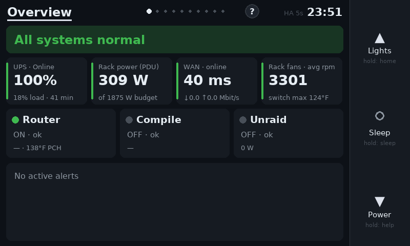
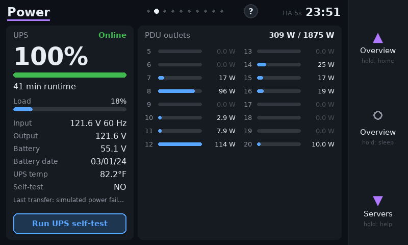
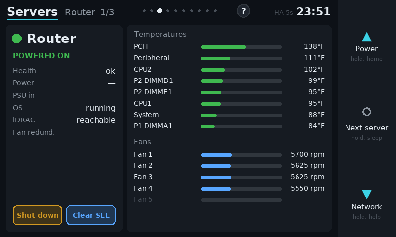
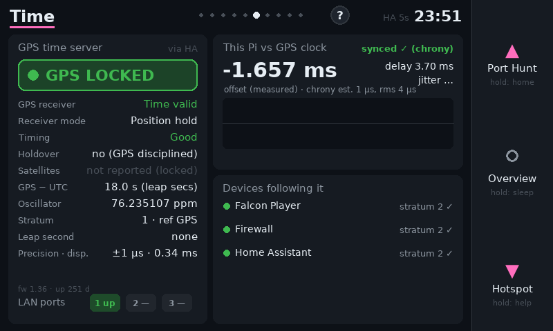
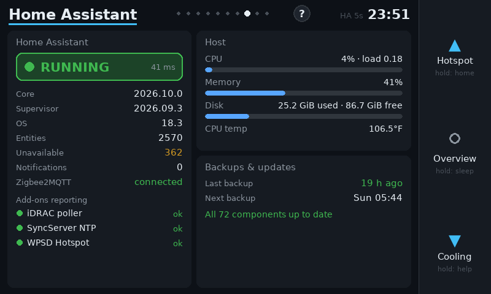
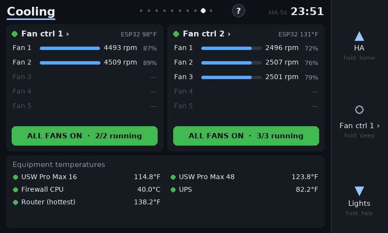
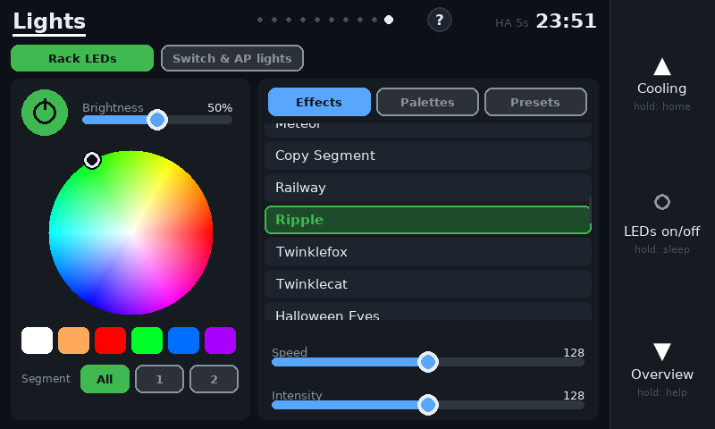

# RackViewer

A native, at-the-rack status display for a Raspberry Pi with the official 7" touchscreen and three
RGB-lit buttons. It shows the health of a home-lab rack (UPS, PDU, servers, network, GPS time,
cooling, a ham-radio hotspot) from Home Assistant, and lets you act on it: power servers on or
off, run a UPS self-test, switch rack fans, drive the rack's WLED lighting, and **Port Hunt**,
which finds a client's switch port and blinks the jack.

| | |
|---|---|
|  |  |
|  |  |
|  |  |
|  | |

## Pages

| Page | What it shows / does |
|---|---|
| **Overview** | One-line rack status, UPS / PDU / WAN / fan tiles, a card per server, all alerts. Tap a tile to jump to its page. |
| **Power** | UPS charge, runtime, load, input/output, battery date, **Run UPS self-test** (the result shows as soon as HA has it); watts per PDU outlet. |
| **Servers** | One iDRAC server at a time: health (and *why* it isn't OK), power, temperatures, fans. **Power On**, **Shut down** (soft / ACPI) and **Clear SEL**, all behind a confirm dialog. Risky ones need a 1.5 s hold. Hard power-off and power-cycle are deliberately not offered. |
| **Network** | Firewall WAN / backup WAN / LTE / VPN, traffic, pings from the rack, switch state and temperatures. |
| **Port Hunt** | Every wired client on one switch. Tap one: its jack is drawn on a faceplate diagram and **blinks on the real switch** (UniFi Etherlighting via UIWLED). |
| **Time** | GPS time server: lock, receiver health, holdover, leap second, oscillator; this Pi's offset and jitter; which network devices follow the GPS clock. |
| **Hotspot** | WPSD digital-voice hotspot in the style of its *Live Caller* page: current/last caller, talkgroup, BrandMeister static/dynamic talkgroups with expiry countdown, last heard. |
| **Home Assistant** | Versions, response time, unavailable entities, Zigbee2MQTT, add-ons reporting, host CPU / memory / disk, backups, pending updates. |
| **Cooling** | Every rack fan's speed and PWM, an **all fans on/off** per controller, per-fan control in a detail view, equipment temperatures. |
| **Lights** | WLED-style control of the rack strip: colour wheel, brightness / speed / intensity sliders, effects, palettes, presets. Etherlight and AP LEDs too. |

## Buttons and LEDs

| Button | Press | Hold |
|---|---|---|
| Top ▲ | previous page | Overview |
| Middle ● | page action (silence alarms, next server, fan details, stop blink, …) | screen off |
| Bottom ▼ | next page | help screen |

- **Middle LED**: whole-rack health. Green, amber or red; pulsing red is a new critical alert
  until you silence it on Overview; breathing blue means no data from HA. On the Time page it
  ticks every GPS second.
- **Top / bottom LEDs**: the current page's colour (matching the bar under the page title);
  they pulse while the hotspot is on air, and follow the rack strip on the Lights page.
- **Door closed**: the screen sleeps (after 60 s) and the three buttons mirror the rack's WLED
  strip live. Opening the door wakes the screen. The door is a switch on the WLED controller's
  button input that selects an "open" and a "closed" preset; RackView watches the active preset.
- The right-hand strip of the touchscreen works like the three buttons.

## Hardware

- Raspberry Pi 4, Raspberry Pi OS Bookworm (Wayfire), official 7" 800x480 DSI touchscreen
- Adafruit AW9523 I2C expander: buttons on pins 1-3 (active low), RGB LEDs in constant-current
  mode on pins (6, 7, 12) top, (13, 14, 15) middle, (11, 10, 9) bottom

## Data sources

RackView reads everything from **Home Assistant** with a single small template query every 5 s,
and talks to the rack's **WLED** controller directly over its WebSocket for live LED colours and
instant control. It expects these integrations / add-ons (each page simply stays empty if one is
missing):

| Needed for | Source |
|---|---|
| Servers | [iDRAC MQTT Poller](https://github.com/richcj10/ha-idrac-plugin) add-on |
| Time | [SyncServer NTP Monitor](https://github.com/richcj10/ha-syncserver-ntp) add-on |
| Hotspot | [WPSD Hotspot Monitor](https://github.com/richcj10/ha-wpsd-hotspot) add-on |
| Port Hunt | [UniFi Port Map](https://github.com/richcj10/ha-unifi-portmap) add-on + [UIWLED](https://github.com/richcj10/UIWLED) |
| Power | NUT (UPS) and UniFi (PDU) integrations; an HA script for the UPS self-test |
| Network | OPNsense integration, UniFi integration |
| Cooling | fancontrol ESP32 boards (EMC2305) publishing MQTT fans and sensors |
| Lights | WLED controller; UIWLED for Etherlight |
| Home Assistant | System Monitor, Backup, Zigbee2MQTT and the update entities |

## Setup

```sh
sudo apt install python3-pygame python3-requests python3-websocket chrony
pip install --break-system-packages adafruit-blinka adafruit-circuitpython-aw9523   # buttons / LEDs

git clone https://github.com/richcj10/RackViewer.git ~/rackview
mkdir -p ~/.config/rackview
cp ~/rackview/config.example.json ~/.config/rackview/config.json   # then edit for your site
( umask 077; echo "<long-lived HA token>" > ~/.config/rackview/ha_token )
```

Start it from Wayfire, replacing any browser kiosk, in `~/.config/wayfire.ini`:

```ini
[autostart]
rackview = /home/<user>/rackview/run.sh

[idle]
# RackView manages screen sleep itself; the Wayfire cube screensaver must be off
screensaver_timeout = -1
dpms_timeout = -1
```

Notes:

- RackView renders through **XWayland** (`SDL_VIDEODRIVER=x11`); SDL's native Wayland backend
  segfaulted under this Wayfire build.
- For accurate time on the Pi use **chrony** pointed at the local GPS server, for example
  `server 192.168.1.44 iburst minpoll 4 maxpoll 6 prefer` in `/etc/chrony/sources.d/`.
- `tools/render_page.py` renders pages to PNG with live data but without touching any hardware
  or sending any commands, which is handy for development over SSH.

## Configuration

All site specifics live in `~/.config/rackview/config.json`; see
[`config.example.json`](config.example.json). The main keys:

| Key | Meaning |
|---|---|
| `ha_url`, `ha_token_file` | Home Assistant URL and the file holding a long-lived token |
| `uiwled_url` | UIWLED add-on API |
| `ping_hosts` | `[label, host or null for the default gateway, critical]` |
| `essential_servers`, `server_names` | iDRAC servers whose power-off is critical; display names |
| `ups_prefix`, `pdu_prefix`, `firewall_prefix` | HA entity prefixes of the NUT, UniFi PDU and OPNsense entities |
| `internet_entity`, `ups_test_script` | optional internet binary_sensor; the UPS self-test script |
| `wled_host`, `door_open_preset`, `door_closed_preset` | rack WLED controller and the presets the door switch selects |
| `extra_lights` | `[label, light entity]` shown on the Lights page (Etherlight, AP LEDs, …) |
| `time_server` | GPS / NTP server the Pi measures itself against |
| `port_hunt_switch` | UIWLED switch name used by Port Hunt |
| `rail_side` | side of the screen the physical buttons are on |
